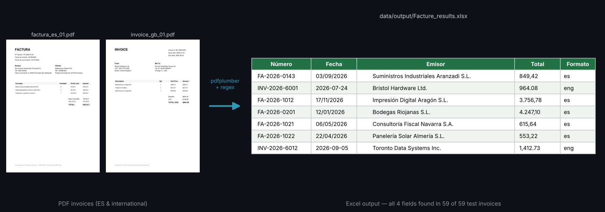
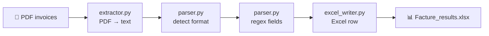

# 🧾 Invoice Extractor

*[Leer en español](README_es.md)*


**Turn a folder of PDF invoices into a clean Excel table — automatically.**

A Python pipeline that reads Spanish and international PDF invoices, detects which fiscal format each one follows, extracts the key fields with rule-based parsing and writes them to Excel. Built as a portfolio project around a real business task: invoice data entry.



---

## ✨ What it does

| Step | How |
|---|---|
| **1 · Read** | Extracts the text of every PDF in `data/input/` with `pdfplumber` |
| **2 · Detect format** | Scores domain markers in the text (`IVA`, `NIF`, `€` vs `VAT`, `Tax ID`, `$`) to pick the Spanish or international ruleset — format detection, not language detection |
| **3 · Extract** | Format-specific regular expressions for **invoice number**, **issue date**, **issuer** and **total** |
| **4 · Export** | Appends one row per invoice to `data/output/Facture_results.xlsx` with `openpyxl` (creates the file and headers on first run) |



## 📊 Results

Tested on a synthetic dataset of **59 invoices** — 30 Spanish and 29 international, from ~25 countries:

| Field | Found |
|---|---|
| Invoice number | 59 / 59 |
| Issue date | 59 / 59 |
| Issuer | 59 / 59 |
| Total | 59 / 59 |
| Format detected (ES / international) | 30 / 29 |

## 🚀 Quick start

```bash
git clone https://github.com/K4iserDev/invoice-extractor.git
cd invoice-extractor

python -m venv .venv
.venv\Scripts\Activate.ps1          # Windows PowerShell
# source .venv/bin/activate         # macOS / Linux

pip install -r requirements.txt
python src/main.py
```

Put your own PDFs in `data/input/` (50+ sample invoices are included) and open `data/output/Facture_results.xlsx`.

## 🗂️ Project structure

```
invoice-extractor/
├── data/
│   ├── input/            # PDF invoices (sample dataset included)
│   └── output/           # generated Excel (git-ignored)
├── docs/                 # images for this README
├── src/
│   ├── config.py         # project-root-relative paths (OS independent)
│   ├── extractor.py      # PDF → plain text
│   ├── parser.py         # format detection + field extraction (regex)
│   ├── excel_writer.py   # structured data → Excel row
│   └── main.py           # runs the full pipeline
├── .env.example          # template for the planned LLM features
└── requirements.txt
```

## 🧠 Design decisions

- **Regex, not an LLM, for financial fields.** Rule-based extraction is deterministic and auditable. For money, a missing field (`None`) is safer than a confident wrong value from a probabilistic model.
- **Format detection by evidence scoring.** Each ruleset counts its own markers instead of deciding "by elimination", so an unclear invoice doesn't get forced into the wrong format.
- **Paths resolved from the project root** (`Path(__file__).resolve()`), so the pipeline runs from any working directory on any OS.

## ⚠️ Known limitations

- Issuer extraction relies on a recognizable legal suffix (`S.L.`, `S.A.`, `Ltd.`, `Inc.`, `LLC`). Others such as `S.L.U.` or `GmbH` are not captured yet.
- Dates and totals are kept as they appear on the invoice (`849,42` vs `964.08`), not normalized.
- Tested on synthetic, digitally generated PDFs — not on scanned invoices (no OCR).

## 🛣️ Roadmap

- [ ] Normalize dates (ISO 8601) and totals (numeric) across formats
- [ ] Validation step that flags invoices with missing fields for manual review
- [ ] Coordinate-based extraction for multi-column layouts (issuer and client side by side)
- [ ] LLM as a **fallback**, clearly flagged as lower confidence, when regex fails
- [ ] LLM categorization of line items (materials, services…)

## 🔗 Related project

**[Invoice-Chatbot](https://github.com/K4iserDev/Invoice-Chatbot)** — ask questions in natural language about the invoices extracted by this tool, using the OpenAI API.

---

**Author:** Asier Martin · [GitHub](https://github.com/K4iserDev) · [LinkedIn](https://www.linkedin.com/in/asier-martin01)
