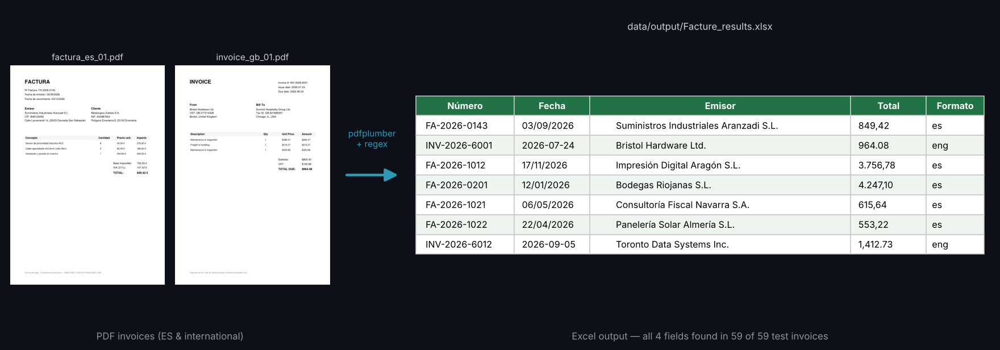
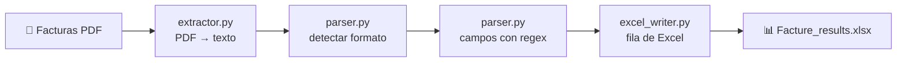

# 🧾 Invoice Extractor

*[Read in English](README.md)*


**Convierte una carpeta de facturas en PDF en una tabla de Excel limpia, de forma automática.**

Pipeline en Python que lee facturas en PDF españolas e internacionales, detecta qué formato fiscal sigue cada una, extrae los campos clave con reglas y los vuelca en un Excel. Proyecto de portfolio construido alrededor de una tarea real de empresa: la introducción manual de facturas.



---

## ✨ Qué hace

| Paso | Cómo |
|---|---|
| **1 · Leer** | Extrae el texto de cada PDF de `data/input/` con `pdfplumber` |
| **2 · Detectar formato** | Puntúa marcadores del dominio en el texto (`IVA`, `NIF`, `€` frente a `VAT`, `Tax ID`, `$`) para elegir las reglas españolas o internacionales. Detecta el formato, no el idioma |
| **3 · Extraer** | Expresiones regulares específicas de cada formato para **número de factura**, **fecha de emisión**, **emisor** y **total** |
| **4 · Exportar** | Añade una fila por factura a `data/output/Facture_results.xlsx` con `openpyxl` (crea el archivo y las cabeceras en la primera ejecución) |



## 📊 Resultados

Probado con un conjunto sintético de **59 facturas**: 30 españolas y 29 internacionales, de unos 25 países.

| Campo | Encontrado |
|---|---|
| Número de factura | 59 / 59 |
| Fecha de emisión | 59 / 59 |
| Emisor | 59 / 59 |
| Total | 59 / 59 |
| Formato detectado (ES / internacional) | 30 / 29 |

## 🚀 Puesta en marcha

```bash
git clone https://github.com/K4iserDev/invoice-extractor.git
cd invoice-extractor

python -m venv .venv
.venv\Scripts\Activate.ps1          # Windows PowerShell
# source .venv/bin/activate         # macOS / Linux

pip install -r requirements.txt
python src/main.py
```

Pon tus PDFs en `data/input/` (se incluyen más de 50 facturas de ejemplo) y abre `data/output/Facture_results.xlsx`.

## 🗂️ Estructura del proyecto

```
invoice-extractor/
├── data/
│   ├── input/            # facturas en PDF (incluye dataset de ejemplo)
│   └── output/           # Excel generado (ignorado por git)
├── docs/                 # imágenes de este README
├── src/
│   ├── config.py         # rutas relativas a la raíz del proyecto (independientes del SO)
│   ├── extractor.py      # PDF → texto plano
│   ├── parser.py         # detección de formato + extracción de campos (regex)
│   ├── excel_writer.py   # datos estructurados → fila de Excel
│   └── main.py           # ejecuta el pipeline completo
├── .env.example          # plantilla para las funciones con LLM previstas
└── requirements.txt
```

## 🧠 Decisiones de diseño

- **Regex y no un LLM para datos financieros.** La extracción por reglas es determinista y auditable. Con dinero, un campo vacío (`None`) es más seguro que un valor erróneo dicho con seguridad por un modelo probabilístico.
- **Detección de formato por puntuación de evidencias.** Cada conjunto de reglas cuenta sus propios marcadores en vez de decidir "por descarte", así una factura ambigua no se fuerza al formato equivocado.
- **Rutas resueltas desde la raíz del proyecto** (`Path(__file__).resolve()`), para que el pipeline funcione desde cualquier carpeta y sistema operativo.

## ⚠️ Limitaciones conocidas

- El emisor se detecta por un sufijo legal reconocible (`S.L.`, `S.A.`, `Ltd.`, `Inc.`, `LLC`). Otros como `S.L.U.` o `GmbH` todavía no se capturan.
- Fechas y totales se guardan tal como aparecen en la factura (`849,42` frente a `964.08`), sin normalizar.
- Probado con PDFs sintéticos generados digitalmente, no con facturas escaneadas (sin OCR).

## 🛣️ Próximos pasos

- [ ] Normalizar fechas (ISO 8601) y totales (numéricos) entre formatos
- [ ] Paso de validación que marque para revisión manual las facturas con campos vacíos
- [ ] Extracción por coordenadas para diseños a varias columnas (emisor y cliente lado a lado)
- [ ] LLM como **respaldo**, marcado como de menor confianza, cuando falle el regex
- [ ] Clasificación con LLM de las líneas de factura (materiales, servicios…)

## 🔗 Proyecto relacionado

**[Invoice-Chatbot](https://github.com/K4iserDev/Invoice-Chatbot)**: haz preguntas en lenguaje natural sobre las facturas extraídas con esta herramienta, usando la API de OpenAI.

---

**Autor:** Asier Martin · [GitHub](https://github.com/K4iserDev) · [LinkedIn](https://www.linkedin.com/in/asier-martin01)
